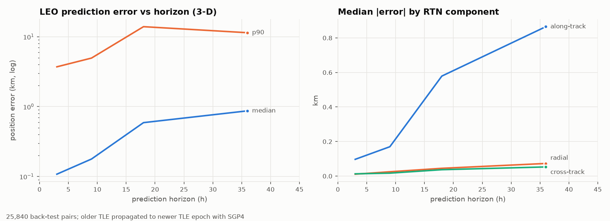
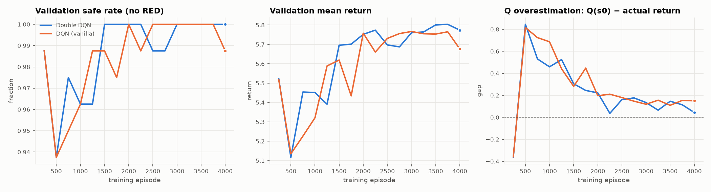

# SentinelFlight

**Fly real rockets through the real sky.** SentinelFlight is a launch and orbit-operations game built on the public space-object catalog. Every satellite and piece of debris is propagated with SGP4, every launch is screened for collisions, and your rocket is integrated from the pad to orbit with real physics. The collision-avoidance AI is the Double DQN agent trained in this repository.

```
Space-Track / CelesTrak ─► auto-refreshed catalog ─► SGP4 in the browser ─► launch-window screening ─► Sentinel AI (Double DQN, verified)
   (server, every 6 h)       (sanity-checked swap)      (web workers)          (blackout chart)            ─► fly it ─► dodge in orbit ─► de-orbit
```

## The game

| Phase | What you do | What is simulated |
|---|---|---|
| **Setup** | Pick a vehicle (Electron, Falcon 9, Falcon Heavy, Soyuz-2.1b/Fregat, PSLV-XL, Ariane 64), site, orbit, payload and lift-off time | Rocket-equation Δv budget per stage, lift-off thrust-to-weight, rotating-Earth launch azimuth |
| **Pre-flight** | Wait for the flight computer and the screening | Pitch-kick search over full ascent simulations; SGP4 propagation of the catalog in web workers; prune with the maneuver envelope |
| **Launch COLA** | Choose a lift-off minute from the launch-window chart, adjust insertion altitude and phasing burn, or ask **Sentinel** | Closest approach and collision probability for every plan; guarded Double DQN with independent re-screening |
| **Flight** | Watch, or take over throttle, steering and staging; chase, tracking, onboard and map cameras; time warp | See *Physics* below. Hard steering through max-Q breaks the vehicle; solids cannot be throttled or shut down |
| **Orbit ops** | Dodge conjunctions with RTN burns, survive fragmentation events, deploy the payload, de-orbit the stage | J2 propagation, live re-screening of every burn, outcome of each close approach drawn from its Pc |
| **Debrief** | Stars and score | Δv losses (gravity / drag / steering), insertion accuracy, safety, sustainability |

The campaign has six missions, from *First Light* (Electron, training) to *Heavy Weather* (Falcon Heavy, pre-launch debris events plus an in-orbit breakup). Free flight lets you fly anything in the catalog window. Progress is saved in the browser.

### Physics (all tested in `tests/js/`)

* **Ascent**: RK4 in the inertial (TEME) frame, with gravity plus J2, drag in the U.S. Standard Atmosphere 1976 relative to the rotating air with a Mach-dependent Cd, and nozzle thrust F = F<sub>vac</sub> − (F<sub>vac</sub> − F<sub>sl</sub>)·p/p₀. Mass flow comes from the vacuum Isp. Steps are cut exactly at burnout; boosters (including PSLV's air-lit pair) and staging are handled, and spent stages fall ballistically to a computed impact point.
* **Guidance**: a pitch kick toward the rotating-Earth azimuth, then a zero-AoA gravity turn with max-Q throttling and a q·α limit, then closed-loop vacuum guidance into a 200 km × target transfer orbit and circularisation at apoapsis. The Electron kick stage, Fregat and PS4 restarts all work as on the real vehicles.
* **Results**: all six vehicles reach their target orbits within 3 % in altitude and 0.1° in inclination, with gravity losses of 1.2–1.5 km/s and drag losses of 50–150 m/s. The Δv accounting closes: ideal − gravity − drag − steering = Δ|v|.
* **Screening**: SGP4 position and velocity every 60 s, cubic Hermite interpolation, a closed-form closest approach per segment refined by golden-section search (within 5 m and 0.05 s of brute force), and Pc from the same non-central χ² model as the Python screener (matches scipy to 1e-6 relative). A full screen of ~2,500 objects takes 15–40 ms.
* **Cross-checks**: GMST matches python-sgp4 to 1e-9 rad. The browser Double DQN matches the numpy policy to 1e-4. On the title screen the page compares satellite.js against python-sgp4 (`/api/sgp4-check`) and shows the largest difference.
* Vehicle figures are approximate public values (`src/interface/static/sf/physics/vehicles.js`).

### Live data

The server refreshes the catalog in the background (`SENTINEL_LIVE=1`, every `SENTINEL_REFRESH_H` hours, at least 2 h apart):

* **Space-Track** (`SPACETRACK_USERNAME` / `SPACETRACK_PASSWORD`): the full public catalog, including payloads, rocket bodies and debris.
* **CelesTrak** fallback (no account): active payloads plus the four large debris clouds. This is a *partial* catalog, and the game labels it so. CelesTrak refuses a repeat download of a group within 2 h, so raw pulls are cached in `data/live_raw/`.
* Each pull is built in a temporary folder, sanity-checked (minimum object count, no future epochs; a pre-launch element set is dropped), then swapped in atomically. A failed or suspicious pull never replaces a good catalog. If the live catalog is older than 4 days, the app falls back to the committed seed snapshot. `/healthz` reports the dataset and refresh status.
* `python -m src.cli live` performs one refresh by hand. The daily GitHub Action runs the same pull as a health check.

---

## Science behind it

The sections below describe the data pipeline, the uncertainty model and the RL agent that SentinelFlight is built on. All numbers come from the scripts in this repo and are committed under [`artifacts/`](artifacts). The screening prune margin was later widened to the full maneuver envelope (see *Bug the tests caught, #2*); the RL tables were produced before that change.

## 1. Data: from raw TLEs to a "super dataset"

| Stage | Result (seed snapshot, Mar 6–13 2025) |
|---|---|
| Raw element sets parsed (column-level validation + checksum) | 59,557 / 59,557 |
| Exact duplicates · same-epoch republications · outside 7-day window | 2,277 · 6,406 · 14 |
| Element sets kept in history | **50,860** |
| Unique objects (latest elset per object = super dataset) | **23,805** (LEO 20,484 · GEO 1,471 · HEO 1,178 · MEO 672) |
| SATCAT join (names, type, radar cross-section) | 13,346 payloads · 8,323 debris · 1,865 rocket bodies · 271 unknown |
| Elset discontinuities → maneuvering payloads | 503 → 415 (the other 88 are fit noise on debris or rocket bodies, which can't maneuver) |

* `src/data/spacetrack_client.py` handles collection. It logs in to Space-Track (credentials from env vars, throttled to their API policy) and pulls `gp`/`gp_history` as 3LE, with CelesTrak as a fallback. A daily GitHub Action ([`collect-tle.yml`](.github/workflows/collect-tle.yml)) builds up the 7-day window.
* `src/data/tle_pipeline.py` builds the window. For each object it keeps the latest elset and adds features computed from its history: decay rate, staleness, maneuver flags, and hard-body radius from RCS.

## 2. How accurate are the predictions? (back-test)

For each of the 17,160 objects with ≥2 elsets, I propagated the older elset to the newer elset's epoch with SGP4 and measured the difference: **25,840 prediction pairs** in total.

| LEO horizon | median error | p90 | along-track / radial (median) |
|---|---|---|---|
| 0–6 h | **0.11 km** | 3.7 km | 0.10 / 0.011 km |
| 6–12 h | 0.18 km | 5.0 km | 0.17 / 0.025 km |
| 12–24 h | 0.59 km | 13.9 km | 0.58 / 0.045 km |
| 24–48 h | 0.87 km | 11.4 km | 0.87 / 0.073 km |

The error is almost entirely **along-track**, roughly 10× the radial error, which is the expected signature of drag uncertainty. A robust (MAD-based) fit gives **σ(age) = 0.05 km + 0.61 km/day**, and this is used as each object's position uncertainty when computing probability of collision.



## 3. Conjunction screening

`src/screening/conjunction.py` works coarse-to-fine:

1. **Altitude-band filter** (perigee/apogee overlap): 23,805 → ~10–14k objects
2. **Vectorized SGP4** (`SatrecArray`) on a 10 s grid that covers every launch time the optimizer might pick
3. **Proximity prune**: keep only objects that come within 120–150 km of any candidate plan, leaving **~1.3–1.9k**
4. **Closed-form TCA**: between samples, relative motion is nearly linear, so the time and distance of closest approach are solved exactly. This is checked against a 1 ms brute force (within 50 m) in `tests/`.
5. **Probability of collision**: 2-D Gaussian in the encounter plane, `Pc = ncx2.cdf((HBR/σ)², 2, (miss/σ)²)`, checked against Monte Carlo in `tests/`. RED means Pc ≥ 1e-4 (NASA CARA maneuver threshold) or miss < 1 km.

> **Bug the tests caught, #2.** The prune used a fixed 150 km margin, but the largest allowed altitude change plus phasing burn moves the vehicle up to ~225 km from nominal, so an object on that path was dropped before screening and neither the agent nor the guard could ever see it. The margin is now computed from the maneuver envelope plus the reporting radius (~250 km), and a regression test covers it.

Building the context takes ~4–8 s per mission. After that, **re-screening any candidate plan takes ~15–20 ms**, and that is what makes RL practical here.

> **Bug the tests caught.** The first version refined the time of closest approach only around the *nearest sample*. At ~15 km/s relative speed, samples are 150 km apart, so a closer encounter (for example one orbit later) could fall between two distant samples. On a test case the screener reported 1.25 km when the true miss was 0.37 km, which **under-reports risk**. The fix refines every segment for any object that could be hiding an encounter. Both RL models were then retrained on the corrected physics.

## 4. Mission model

`src/physics/mission.py`: the launch site is rotated into the TEME frame using Greenwich sidereal time, so slipping the launch shifts the orbit plane at exactly Earth's rotation rate (tested). The launch azimuth comes from `sin β = cos i / cos φ_geocentric`. Ascent follows a smooth kinematic profile whose speed at insertion matches circular velocity, and after insertion the orbit is propagated as Keplerian. The legacy code compared Earth-fixed rocket positions with inertial (TEME) debris positions, which made every distance meaningless. Everything is now in one frame.

## 5. Double DQN avoidance agent

`src/rl/` frames avoidance as an MDP:

* **Actions (7):** COMMIT · launch slip ±60 s · insertion altitude ±2 km · phasing burn ±0.5 m/s, with masks for the launch window, ±10 km, ±3 m/s and a 10 m/s Δv budget
* **State (48):** current plan, fuel used, launch window and steps left, plus the 5 most dangerous conjunctions (proximity, time to TCA, RTN miss vector, log Pc, relative speed, RED flag)
* **Reward:** potential-based shaping on a risk potential (which leaves the optimal policy unchanged), minus 0.25 per m/s of Δv, 0.1 per minute of slip and 0.02 per step, plus a terminal score for no RED / no AMBER
* **Agent:** Double DQN (online network picks the next action, target network scores it), dueling head, Huber loss, Polyak target updates, action masking. Trained in PyTorch (4,000 episodes, ~8.5 min on a laptop CPU) and exported to **numpy** for serving, so the web app needs no PyTorch (forward pass: 13 µs).
* **Scenarios:** real-catalog background (so an action can *create* new risk, for example climbing into the Starlink shell) plus injected crossings and fragment clouds, and launch windows from instantaneous to ±10 min. Training and test missions are disjoint.

### Held-out results: 200 scenarios, 6 unseen missions (156 have a RED conjunction if nothing is done)

| Policy | Safe (no RED) | Clean (no AMBER) | Δv m/s | Cost ↓ | Screenings / plan | ms / plan |
|---|---|---|---|---|---|---|
| No avoidance | 22.0% | 11.5% | 0 | 5.95 | 1 | 16 |
| Random | 73.0% | 35.0% | 1.17 | 0.75 | 4.9 | 78 |
| Greedy one-step lookahead | 100% | 93.0% | 0.58 | −2.25 | 13.7 | 243 |
| DQN (ablation) | 100% | 79.5% | 0.92 | −2.07 | 3.6 | 84 |
| Double DQN | 99.5% | 82.0% | 0.75 | −2.06 | 4.3 | 85 |
| **Double DQN + verification guard** | **100%** (95% CI 98.1–100) | 82.0% | 0.74 | −2.09 | **5.3** | 82 |
| Grid search (80-scenario subset) | 100% | 100% | 0.57 | −2.28 | 294 | 4,738 |

**What these results support:**
* The guarded DDQN is **100% safe** on held-out missions. It reaches **92% of the brute-force grid's objective value (−2.11 vs −2.28 on the same 80 scenarios) with 56× fewer screenings**, and needs 2.6× fewer screenings than greedy search. In a real operations setting, each screening runs a high-fidelity ephemeris against the whole catalog and takes minutes, so the number of screenings is the cost that matters.
* **Greedy lookahead finds better plans** (93% vs 82% clean). Conjunctions are very sharply localized in decision space, so a one-step search almost always finds a fix. The honest value of the learned policy is amortized cost, not better plans.
* **DDQN vs vanilla DQN is a tie here.** With ≤10-step episodes, there is little bootstrapping for overestimation bias to build up in. Both gaps fall to ~0.1–0.15 (see figure).
* The guard (re-screen the committed plan, fall back to greedy if anything is still RED) triggered in 0.5% of cases and turned 99.5% into 100%.



### Real catalog, no injected threats
Out of 30 random launches against the March 2025 catalog, **11 had an AMBER conjunction and 0 had a RED one** (median closest approach 6.1 km), almost all in the ~540–560 km Starlink shell. Example: **Falcon 9 → 550 km at 2025-03-12 06:00 UTC** passes **STARLINK-2224 at 1.40 km (Pc 1.6e-5)**. The agent's plan was to launch 60 s earlier, which clears every AMBER (new minimum miss 7.7 km) with **0 m/s of extra Δv** and 3 screenings.

## Run it

```bash
python -m venv .venv && source .venv/bin/activate
pip install -r requirements-train.txt          # serving only: requirements.txt

python run.py                                  # http://127.0.0.1:5000  SentinelFlight (/planner, /evidence)
SENTINEL_LIVE=1 python run.py                  # ... with background live-catalog refresh
python -m src.cli live                         # refresh the live catalog once (data/live/)

python -m pytest -q                            # Python: pipeline, screening, RL, API, live data
node --test tests/js/*.test.mjs                # game physics: ascent, J2, atmosphere, Pc, TCA, AI parity, pipeline

python -m src.cli all                          # rebuild the seed dataset + back-test + figures
python -m src.cli plan --rocket "Falcon 9" --alt 550 --launch 2025-03-12T06:00
python -m src.rl.train --episodes 4000         # Double DQN   (--vanilla for the DQN ablation)
python -m src.rl.evaluate --scenarios 200      # held-out comparison -> artifacts/evaluation.json
python -m src.cli export-policy                # DDQN weights -> the in-browser Sentinel
```

## Deployment

* **Live app (Render):** https://enhanced-space-debris-avoidance-and.onrender.com (free tier: the first visit after idle takes ~1 min to wake up)
* **Landing page (GitHub Pages, `docs/`):** https://thrishankkuntimaddi.github.io/Enhanced-Space-Debris-Avoidance-and-Trajectory-Optimization-System/
* **CI:** `.github/workflows/ci.yml` runs the test suite on every push; `collect-tle.yml` pulls a TLE snapshot daily.

Built to fit a 512 MB instance:

| Concern | What the app does |
|---|---|
| Memory | One heavy plan at a time across all threads *and* worker processes (file lock); SGP4 and TCA refinement run in chunks; the catalog cache is freed and the heap trimmed after each plan. Measured peak for one plan: ~313 MB; an idle worker: ~47 MB. |
| No PyTorch in production | The policy is served from `models/ddqn_policy.npz` with a numpy forward pass (13 µs). |
| Slow CPU, ephemeral disk | The 4 demo presets ship precomputed in `data/preset_cache/` (`python -m src.cli presets`), so they answer instantly even right after a free-tier wake-up wipes the disk. Other identical requests are served from a disk cache. A brand-new mission takes ~70 s on Render's free CPU (~5 s on a laptop). |
| Payload | Responses are gzipped; the moving catalog ships as int16 at 2 km resolution (~1 MB per plan). |
| Ops | `/healthz` reports pid, uptime and warm-up stage/timings. Warm-up starts inside each worker on its first request, never at import: with `gunicorn --preload` the app is imported in the master and forked, and threads don't survive a fork. `gunicorn.conf.py` sets 1 worker, 4 threads, a 300 s timeout and worker recycling. |

`render.yaml` describes the service as a Blueprint. For a service created in the dashboard, set **Start Command** to `gunicorn "src.interface.app:app"` (so `gunicorn.conf.py` applies) and **Build Command** to `pip install -r requirements.txt && python -m src.cli build`.

## Layout

```
src/data/        spacetrack_client.py · tle_pipeline.py · propagation_validation.py
src/physics/     frames.py (TEME/GMST/RTN) · mission.py (ascent + Kepler, maneuver plan)
src/screening/   conjunction.py (filters, vectorized SGP4, TCA, Pc)
src/rl/          env.py · scenarios.py · ddqn.py · policies.py · train.py · evaluate.py
src/pipeline/    planner.py (end-to-end) · src/reporting/figures.py · src/cli.py
src/data/        live.py (auto-refresh) · active.py (live vs seed)
src/interface/   Flask app; static/sf/ = SentinelFlight (physics/, ai/, game/, workers/)
tests/js/        node tests for the game physics
artifacts/       committed metrics & figures      models/ddqn_policy.npz  serving weights
legacy/          the pre-rebuild implementation (kept for comparison)
classic planner  /planner: server-side screening + guarded DDQN (the original console)
```

## Limits (on purpose)
* Public TLEs come without covariance, so σ is isotropic and comes from our own back-test. Operational collision assessment uses special-perturbation ephemerides and full covariance.
* The ascent is kinematic and the post-insertion orbit is two-body over a ~2.5 h horizon (no drag or J2).
* This is a decision-support prototype, not a launch-COLA system of record.
